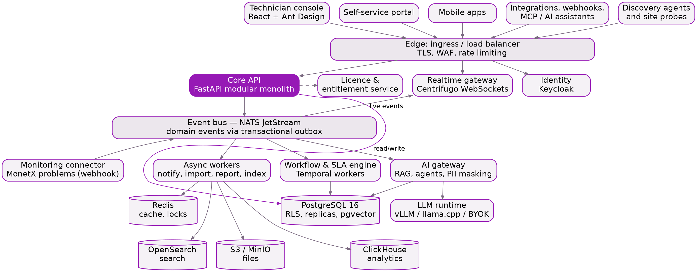
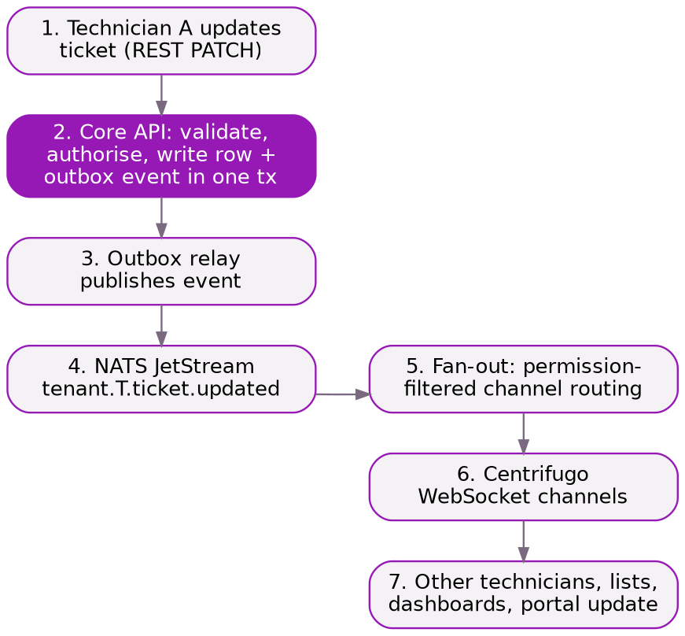
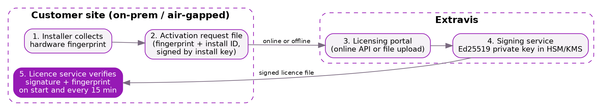

**SupportX v2**

Architecture Document

<table>
<colgroup>
<col style="width: 100%" />
</colgroup>
<tbody>
<tr class="odd">
<td>
<strong>Greenfield platform architecture for an enterprise ITSM and ESM suite</strong>

Python + React • Real-time everywhere • SaaS and on-prem from one codebase • Fingerprint-bound licensing
</td>
</tr>
</tbody>
</table>

| **Item**               | **Detail**                                 |
|------------------------|--------------------------------------------|
| **Document**           | SupportX v2 Architecture Document          |
| **Version**            | v0.2 (Draft for engineering review)        |
| **Date**               | 22 October 2026                            |
| **Companion document** | SupportX v2 Product Planning Document v0.1 |
| **Prepared by**        | Technical Project Management, Extravis     |
| **Classification**     | Internal / Confidential                    |

**WWW.EXTRAVIS.CO**

**Contents**

# 1. Introduction

## 1.1 Purpose

This document defines the target architecture for SupportX v2, built from scratch as an enterprise IT and enterprise service management platform. The functional goal is full feature parity with ManageEngine ServiceDesk Plus, then clear superiority in real-time experience, deployment flexibility, MonetX integration and AI. Section 2 fixes the functional scope as a ServiceDesk Plus parity baseline; the remaining sections define how the platform is built.

It is written for the engineering team, and is intended to be the reference that technical decisions are measured against for the multi-year build. Decisions that still need confirmation are listed as Architecture Decision Records (ADRs) in Section 19.

## 1.2 Architectural goals

| **Goal**                           | **What it means in practice**                                                                                                                                   |
|------------------------------------|-----------------------------------------------------------------------------------------------------------------------------------------------------------------|
| **One codebase, every deployment** | SaaS, private cloud, on-prem and air-gapped run the same build. Licensing decides features, never the deployment model.                                         |
| **Real-time everywhere**           | No page refresh anywhere in the product. Lists, records, dashboards, approvals and the portal update live over WebSockets.                                      |
| **Enterprise scale**               | Horizontally scalable stateless services; designed for tens of thousands of technicians and hundreds of millions of records per SaaS region.                    |
| **Metadata-driven**                | Custom fields, forms, layouts, statuses, life cycles and workflows are configuration, not code changes.                                                         |
| **Secure and tamper-resistant**    | Tenant isolation enforced in the database, zero-trust service calls, and licensing that cannot be copied between machines or edited.                            |
| **Modern, human UI**               | Ant Design based console, aggressive real-time dashboards, and no raw system values on screen (for example "Incident Management", never "INCIDENT_MANAGEMENT"). |
| **Operable**                       | Observability, zero-downtime upgrades and offline update bundles are designed in from day one, not added later.                                                 |

## 1.3 Design targets

These targets drive capacity planning and load testing. They are engineering targets, not contractual SLAs.

| **Dimension**                        | **Target**                                                          |
|--------------------------------------|---------------------------------------------------------------------|
| **Concurrent technicians**           | 10,000 per deployment (SaaS cell or large on-prem cluster)          |
| **Concurrent WebSocket connections** | 100,000 per realtime cluster, horizontally scalable                 |
| **Ticket volume**                    | 10 million+ work items per tenant without degraded list performance |
| **API latency (p95)**                | Reads under 200 ms, writes under 400 ms at target load              |
| **Realtime propagation (p95)**       | Under 1 second from commit to every subscribed screen               |
| **List view**                        | 50-row page with filters and sort under 300 ms on 10 million rows   |
| **Dashboard refresh**                | Live widgets update within 2 seconds of the underlying change       |
| **SaaS availability**                | 99.9% monthly per region (99.95% for premium tier)                  |
| **Recovery (SaaS)**                  | RPO 15 minutes, RTO 4 hours                                         |
| **Smallest on-prem install**         | Single node, 8 vCPU, 32 GB RAM, up to about 50 technicians          |

## 1.4 Out of scope for this document

- Detailed functional specifications per screen (Section 2 sets the capability baseline; screen-level specs live in the product backlog).

- Commercial pricing (covered by the Product Planning Document).

- Visual design specifications (to be produced as the design system in Phase 0).

# 2. Functional scope: ServiceDesk Plus parity baseline

The functional baseline for SupportX v2 is everything ManageEngine ServiceDesk Plus offers, taking the Enterprise edition with Cloud and On-Prem features combined. Every capability listed in this section must exist in SupportX v2, on both SaaS and on-prem. Capabilities that SDP offers only in its Cloud version are still required on SupportX on-prem.

The only exclusion is network and infrastructure monitoring (the OpManager, Site24x7, NetFlow Analyzer and Applications Manager side of the ManageEngine suite). That is provided by MonetX, and SupportX connects to it through the Monitoring connector.

<table>
<colgroup>
<col style="width: 100%" />
</colgroup>
<tbody>
<tr class="odd">
<td>
<strong>Parity rule</strong>

Parity means the same capabilities and outcomes, not a copy of ManageEngine's screens, wording or artwork. SupportX v2 screens are designed originally on the Ant Design system. Where SDP depends on a separate ManageEngine product to deliver a visible feature (for example endpoint discovery, AD password self-service, advanced analytics), SupportX delivers it natively or through Extravis products (AgentX, PatchX).
</td>
</tr>
</tbody>
</table>

## 2.1 Incident Management

| **Capability**             | **Parity requirement**                                                                                                                                                                 |
|----------------------------|----------------------------------------------------------------------------------------------------------------------------------------------------------------------------------------|
| **Omnichannel logging**    | Email, self-service portal, phone (CTI), live chat, virtual agent, Microsoft Teams, Slack, WhatsApp, mobile app, REST API, and MonetX problems.                                        |
| **Email to ticket**        | Multiple mailboxes, parser rules (route, categorise, set fields from content), spam filters, reply threading into conversations, loop protection.                                      |
| **Incident templates**     | Drag-and-drop form designer, separate technician and requester layouts, help cards, field and form rules (show, hide, mandatory, set value), custom scripts.                           |
| **Classification**         | Category, subcategory and item hierarchy; impact, urgency and priority matrix; request type; mode; site and group.                                                                     |
| **Assignment**             | Technician groups, round-robin and load-balanced auto-assignment, assignment by availability and skills, backup technicians, pick-up from queue.                                       |
| **Request life cycle**     | Drag-and-drop status canvas, conditional transitions, actions before, during and after transitions, mandatory fields per transition, restricted transitions by role.                   |
| **Visual workflows**       | Graphical workflows for incidents with conditions, switches, approvals, notifications, field updates, timers, tasks, webhooks and custom functions.                                    |
| **Major incident**         | Major incident template and life cycle, multistage notifications, linked child incidents, post-incident review.                                                                        |
| **Work on the ticket**     | Conversations, public and private notes, reply and resolution templates, canned responses, forward, attachments, tasks with dependencies, checklists, reminders, worklogs with timers. |
| **Relationships**          | Link and merge requests, parent and child, associate problems, changes, releases, assets, CIs and projects.                                                                            |
| **Closure**                | Closure codes, closure rules (mandatory fields), resolution, reopen rules, natural-language reopen from email replies, satisfaction survey on closure.                                 |
| **Views and productivity** | List, card, Kanban and calendar views, saved and shared views, bulk actions, quick actions, follow request updates, trash and recovery, scheduled archiving.                           |
| **Announcements**          | Company-wide and group-specific announcements and banners to reduce duplicate incidents.                                                                                               |

## 2.2 Service Request Management and Service Catalog

| **Capability**            | **Parity requirement**                                                                                                                                          |
|---------------------------|-----------------------------------------------------------------------------------------------------------------------------------------------------------------|
| **Catalog structure**     | Hierarchical service categories, catalog items with their own forms, business and technical catalog views, store-style browsing and search.                     |
| **Service templates**     | Drag-and-drop fields, technician and requester views, resource information (for example "select one of my assets"), form rules and scripts.                     |
| **Approvals**             | Multi-stage and multi-level approvals (at least 5 stages), approval by role or manager, email and mobile approvals, reminders, delegation and backup approvers. |
| **Fulfilment**            | Task templates with dependencies and auto-assignment, fulfilment workflows, onboarding and offboarding orchestration across HR, IT and facilities.              |
| **Entitlements**          | Visibility of catalog items by user group, department, site and role.                                                                                           |
| **SLAs and cost**         | Service-specific SLAs; cost per item and charge-back information.                                                                                               |
| **Conversions and links** | Convert between service request and incident; link service requests to purchase requests and orders.                                                            |

## 2.3 Problem Management

| **Capability**               | **Parity requirement**                                                                                                   |
|------------------------------|--------------------------------------------------------------------------------------------------------------------------|
| **Problem records**          | Created from incidents or standalone, problem templates with form rules, copy problem, trash and recovery.               |
| **Analysis**                 | Impact, root cause and symptoms sections; workaround; resolution; mark as known error to build the known error database. |
| **Life cycle and workflows** | Problem life cycle canvas (for example a Five Whys flow), visual problem workflows, problem approvals.                   |
| **Associations**             | Link many incidents to one problem; associate changes, releases and CIs; CMDB impact view.                               |
| **AI**                       | Problem prediction by clustering similar incidents, technician prediction, AI root-cause draft.                          |
| **Communication**            | Announcements linked to problems; closure codes; problem widgets on dashboards.                                          |

## 2.4 Change Management

| **Capability**          | **Parity requirement**                                                                                                                                                   |
|-------------------------|--------------------------------------------------------------------------------------------------------------------------------------------------------------------------|
| **Change types**        | Standard, normal, emergency, major, minor and custom types; pre-approved standard change catalog.                                                                        |
| **Templates and roles** | Change templates with stage-specific sections, custom change roles (change manager, implementer, reviewer ...), CAB definitions including requesters.                    |
| **Stages**              | Submission, planning, CAB evaluation, implementation, UAT, release, review and closure, each with custom statuses and guided transitions; restrict stage access by role. |
| **Planning**            | Impact analysis, rollout plan, backout plan, implementation checklist, planned and actual downtime, scheduled start and end.                                             |
| **Risk**                | Manual risk, risk questionnaire with scoring, risk by business rules, AI change risk prediction.                                                                         |
| **Approvals**           | Multi-stage and multi-level CAB approvals, reminders, backup approvers, clarification requests.                                                                          |
| **Scheduling**          | Change calendar (week and month), freeze windows and maintenance windows (recurring, scoped to services, sites or all changes), conflict detection.                      |
| **Automation**          | Visual change workflows with all node types, timers, business rules for changes, triggers, abort process, custom functions and webhooks.                                 |
| **SLAs**                | Change SLAs with response and resolution escalations.                                                                                                                    |
| **Associations**        | Incidents, problems, releases, projects, purchase orders and CIs; CMDB impact view of affected services.                                                                 |
| **Review**              | Post-implementation review, closure codes and closure rules.                                                                                                             |

## 2.5 Release Management

| **Capability**          | **Parity requirement**                                                                                                                         |
|-------------------------|------------------------------------------------------------------------------------------------------------------------------------------------|
| **Release records**     | Created from changes, incidents or problems; templates with layouts; release types; roles; stages and custom statuses with guided transitions. |
| **Planning and stages** | Release plans with checklists, build, test and deployment stages, post-deployment training and review.                                         |
| **Automation**          | Release workflows, notification rules, approval reminders, timers, triggers, custom menu actions.                                              |
| **Structure**           | Parent and sub-releases, import releases, release dashboard.                                                                                   |
| **Calendar**            | Release calendar combined with the change calendar.                                                                                            |
| **Associations**        | Link releases to changes, assets and CIs; closure codes.                                                                                       |
| **DevOps**              | Jira, Azure DevOps and GitLab links and issue creation (GitHub added in SupportX).                                                             |

## 2.6 SLA Management

| **Capability**    | **Parity requirement**                                                                                                                                                      |
|-------------------|-----------------------------------------------------------------------------------------------------------------------------------------------------------------------------|
| **SLA policies**  | SLAs for incidents, service requests and changes; site-specific SLAs; criteria-based auto-selection by priority, impact, urgency, category, department, requester or VIP.   |
| **Targets**       | First response, response and resolution targets; operational hours, holidays and per-site calendars; option to ignore business hours for critical tickets.                  |
| **Timer control** | Pause SLA on chosen statuses (for example awaiting requester), resume automatically.                                                                                        |
| **Escalations**   | Response escalation plus up to four resolution escalation levels, pre-breach and post-breach; actions: notify, reassign, change group, raise priority, run custom function. |
| **OLAs**          | Operational level agreements inside SLAs for internal support groups.                                                                                                       |
| **Visibility**    | SLA countdown on every ticket, violation flags, SLA compliance reports and widgets.                                                                                         |

## 2.7 Dashboards

| **Capability**         | **Parity requirement**                                                                                                                     |
|------------------------|--------------------------------------------------------------------------------------------------------------------------------------------|
| **Dashboard types**    | Technician, manager and executive dashboards; scheduler and technician availability chart; custom dashboards per role or team.             |
| **Widgets**            | KPI cards, charts from any report, lists with in-widget actions (assign, close, link), pending approvals, tasks and reminders.             |
| **Interaction**        | Site and group filters, drill-down to records, instant graph view inside any list view.                                                    |
| **Sharing**            | Dashboard permissions by role, group and user.                                                                                             |
| **AI usage dashboard** | Equivalent of the Zia dashboard: prediction volumes, generative AI usage per feature, provider and user, token consumption, chatbot flows. |

## 2.8 Reporting

| **Capability**              | **Parity requirement**                                                                                                                    |
|-----------------------------|-------------------------------------------------------------------------------------------------------------------------------------------|
| **Prebuilt reports**        | At least 150 out-of-the-box reports across requests, problems, changes, releases, assets, software, contracts, purchase, SLA and surveys. |
| **Custom report types**     | Tabular, matrix, summary, and audit or scan reports, each with chart options.                                                             |
| **Report features**         | Column choice, filters, grouping, sorting, calculated columns, trend reports, flash reports, drill-down analysis.                         |
| **Scheduling and delivery** | Scheduled reports by email in PDF, Excel and CSV; report folders with permissions.                                                        |
| **SQL query reports**       | Read-only SQL reports for advanced administrators against the reporting store, with tenant and permission filters applied.                |
| **Export**                  | Export any list or report to CSV, Excel and PDF.                                                                                          |

## 2.9 Visual Query Builder

SDP builds custom reports through a step-by-step wizard. SupportX provides a full visual query builder so non-technical users can build any report or filter without SQL.

| **Capability**               | **Parity requirement**                                                                                                                                                |
|------------------------------|-----------------------------------------------------------------------------------------------------------------------------------------------------------------------|
| **Entity selection**         | Pick a starting module; related entities (requester, technician, asset, CI, SLA, approvals) are added by following relationships, with joins generated automatically. |
| **Columns and calculations** | Drag columns, add calculated fields, date bucketing (day, week, month, quarter), duration calculations (time to resolve, time in status).                             |
| **Filters**                  | AND and OR groups, relative dates ("last 30 days"), run-time prompts and parameters.                                                                                  |
| **Aggregation**              | Group by, count, sum, average, minimum, maximum, percentiles; pivot to matrix.                                                                                        |
| **Preview and visualise**    | Live preview while building, choose any chart type, save as report or dashboard widget, schedule.                                                                     |
| **Reuse**                    | The same builder powers list view filters, business rule criteria, SLA criteria and dashboard widgets.                                                                |

## 2.10 AI

Parity with the full Zia feature set, delivered on SaaS and on-prem with a local model option.

| **Capability**     | **Parity requirement**                                                                                                                                                                                                                                         |
|--------------------|----------------------------------------------------------------------------------------------------------------------------------------------------------------------------------------------------------------------------------------------------------------|
| **Predictive**     | Category, subcategory and item; priority; template; technician and group; problem prediction; change risk; sentiment; email intent for approvals, reopen and asset acknowledgement.                                                                            |
| **Generative**     | Reply assist, text assist, resolution assist, conversation summary, solution (KB) generator and translation, RAG answers with citations, PIR and root-cause drafts, checklist generator, script and code generator, workflow assist from text, voice or image. |
| **Conversational** | Virtual agent in portal, Teams and website widget; text, voice and image input; ticket actions by chat; natural-language reports.                                                                                                                              |
| **Agents**         | Prebuilt agent store, no-code agent studio, multi-agent orchestrator, guardrails, PII masking, session observability.                                                                                                                                          |
| **Control**        | Choice of model provider per capability, local LLM, usage and outcome dashboard, MCP server for external AI assistants.                                                                                                                                        |

## 2.11 Asset Management (ITAM and SAM)

| **Capability**                | **Parity requirement**                                                                                                                                                                                                                   |
|-------------------------------|------------------------------------------------------------------------------------------------------------------------------------------------------------------------------------------------------------------------------------------|
| **Asset model**               | IT and non-IT asset types, product types with parent and child types, components, consumables, custom forms per product type.                                                                                                            |
| **Lifecycle**                 | Asset states, drag-and-drop asset life cycle, asset workflows and triggers, asset auto-assignment, user and workstation mapping, ownership history.                                                                                      |
| **Financials**                | Purchase cost, depreciation methods, cost centres, GL codes, asset age, depreciated asset reports.                                                                                                                                       |
| **Tagging**                   | Barcode and QR generation with label designer, RFID bulk scanning in the mobile app.                                                                                                                                                     |
| **Operations**                | Asset loan and booking, replenishment thresholds per site, consumable allocation, asset acknowledgement by user, asset audits.                                                                                                           |
| **Software asset management** | Software catalogue, licence types (individual, volume, CAL, OEM, concurrent, subscription, suites, upgrade and downgrade), compliance (over and under licensed), prohibited software, software metering, Microsoft 365 licence tracking. |
| **Purchase**                  | Purchase requests and orders, approvals, vendor and product catalogues, price comparison, delivery, invoices and payments, reconcile received items into assets.                                                                         |
| **Contracts**                 | Contracts with documents, parent and child contracts, renewals, auto-renewal, expiry alerts, usage tracking, associated assets.                                                                                                          |
| **Access**                    | Fine-grained asset access by product type, state, site and user attribute.                                                                                                                                                               |

## 2.12 CMDB

| **Capability**      | **Parity requirement**                                                                                                                                                          |
|---------------------|---------------------------------------------------------------------------------------------------------------------------------------------------------------------------------|
| **CI model**        | Custom CI types with attributes and inheritance, custom relationship types, CI states, attached documents.                                                                      |
| **Population**      | Sync rules from assets and discovery, identifier rules, field mapping, reconciliation and de-duplication, integration mapping showing each CI's source; MonetX topology import. |
| **Visualisation**   | Relationship map canvas, business views per service with ticket counters, export map as image or CSV.                                                                           |
| **Impact analysis** | Impact path by depth and direction, used from incidents, problems and changes.                                                                                                  |
| **Governance**      | Baselines with compare (added, removed, modified), CI version history, data quality policies (completeness, staleness, orphans) with per-CI scores, CMDB dashboard.             |
| **Operations**      | CI downtime records, triggers and custom actions, fine-grained CI access, contract associations.                                                                                |

## 2.13 Discovery (agent and agentless)

SDP relies on the Endpoint Central agent and ManageEngine probes. SupportX provides its own discovery agent and probes; Section 6.9 describes the architecture.

| **Capability**           | **Parity requirement**                                                                                                                                                                        |
|--------------------------|-----------------------------------------------------------------------------------------------------------------------------------------------------------------------------------------------|
| **Agent-based**          | Lightweight agent for Windows, macOS and Linux collecting hardware, software, OS, patches, services, logged-on users and peripherals, with scheduled and on-demand scans and change tracking. |
| **Agentless**            | Windows via WMI and WinRM, Linux, Unix and macOS via SSH, SNMP inventory for printers and network devices (inventory only, no monitoring), VMware vCenter and Hyper-V for virtual machines.   |
| **Distributed scanning** | On-site probes for remote locations and isolated networks, uploading results securely to the central server.                                                                                  |
| **Other sources**        | Active Directory computer import, Microsoft Intune, SCCM / MECM, Lansweeper, cloud accounts (AWS, Azure, GCP), CSV import.                                                                    |
| **Scan management**      | Scan schedules, credential vault, scan history and audit, scan failure list with reasons.                                                                                                     |
| **Remote support**       | Remote control of a discovered machine from the ticket or asset (via AgentX, or TeamViewer / AnyDesk integration).                                                                            |

## 2.14 Integrations

All SDP integration categories except network monitoring, with equivalents where SDP integrates with other ManageEngine products.

| **Capability**           | **Parity requirement**                                                                                                                                           |
|--------------------------|------------------------------------------------------------------------------------------------------------------------------------------------------------------|
| **AI**                   | OpenAI, Azure OpenAI, Google Gemini, Anthropic Claude, local LLM; MCP server.                                                                                    |
| **Automation and iPaaS** | Zapier, Microsoft Power Automate, n8n, generic webhooks in and out.                                                                                              |
| **Collaboration**        | Microsoft Teams (bot, notifications, approvals), Slack, Outlook add-in, actionable messages, Microsoft 365 calendar, WhatsApp, Google Chat.                      |
| **Telephony**            | CTI integration for screen pop and call logging (generic SIP / 3CX / cloud telephony providers).                                                                 |
| **DevOps**               | Jira, Azure DevOps, GitLab, GitHub.                                                                                                                              |
| **Endpoint and UEM**     | AgentX and PatchX (native), Microsoft Intune, SCCM / MECM, Lansweeper, patch deployment from tickets via PatchX.                                                 |
| **Identity**             | Active Directory and LDAP, Entra ID, Okta, Google, SAML; user and group sync; AD self-service password reset and unlock built in (SDP needs ADSelfService Plus). |
| **Security tools**       | SIEM and log tools as incident sources (Wazuh, Splunk, QRadar, Microsoft Sentinel) and privileged access tools for ticket validation.                            |
| **Analytics**            | Power BI and other BI tools through a read-only reporting connector.                                                                                             |
| **ITSM and knowledge**   | ServiceNow and Jira Service Management ticket sync, Confluence and SharePoint knowledge sources.                                                                 |
| **Remote access**        | TeamViewer, AnyDesk, AgentX remote control.                                                                                                                      |
| **Monitoring**           | MonetX connector (native); generic alert webhook for other tools. No monitoring inside SupportX.                                                                 |

## 2.15 Also in scope at parity

Everything else SDP provides is also in scope, at the same level of depth:

| **Capability**                    | **Parity requirement**                                                                                                                               |
|-----------------------------------|------------------------------------------------------------------------------------------------------------------------------------------------------|
| **Self-service portal**           | Branded portal, catalog, knowledge, announcements, my assets, my requests and approvals, custom domain, portal widgets and layouts per audience.     |
| **Knowledge base**                | Topics, templates, versions, approvals, expiry and review dates, ratings and comments, publish to portal, linking to tickets.                        |
| **Live chat**                     | Chat to ticket, attachments, routing to expert groups, canned responses, website widget.                                                             |
| **Projects**                      | Projects, milestones, tasks, Gantt, Kanban, resource heatmap, timesheets, MS Project import.                                                         |
| **Enterprise service management** | HR, facilities, finance and legal desks, unified portal, space management (campus, building, floor, room) and room booking.                          |
| **Automation and customisation**  | Business rules, custom triggers, custom actions and menus, custom functions, custom modules, sandbox, preventive maintenance tasks, scheduler.       |
| **Administration**                | Multi-site, multi-language (40+ including Arabic and Urdu with RTL), multi-currency, operational hours, holidays, roles and permissions, audit logs. |
| **Mobile apps**                   | iOS and Android technician and approver apps with push notifications, voice dictation, barcode and RFID scanning.                                    |
| **Compliance tooling**            | GDPR and HIPAA controls: PII encryption, right to be forgotten, anonymisation, secure export.                                                        |
| **MSP**                           | Multi-customer support with per-customer catalogs, SLAs, contracts, time tracking and billing (SDP sells this as a separate product).                |

**Out of scope:** network, server and application monitoring, bandwidth and flow analysis, and alert correlation. These are MonetX capabilities.

# 3. Architecture principles

| **\#**  | **Principle**                                       | **Rationale**                                                                                                                                                                                                                                                         |
|---------|-----------------------------------------------------|-----------------------------------------------------------------------------------------------------------------------------------------------------------------------------------------------------------------------------------------------------------------------|
| **P1**  | Modular monolith first, services where they earn it | Microservices from day one would slow a small team for years. Domain modules live in one deployable with strict boundaries; components with different scaling or runtime needs (realtime, workers, AI, discovery, licensing) are separate deployables from the start. |
| **P2**  | API-first                                           | Every UI action goes through the same public, versioned REST API. The UI, mobile apps, integrations, AI agents and the MCP server all use one contract.                                                                                                               |
| **P3**  | Event-driven by default                             | Every state change emits a domain event through a transactional outbox. Realtime updates, notifications, search indexing, analytics, workflows and audit all consume events rather than being called inline.                                                          |
| **P4**  | Tenant isolation in the database                    | Every row carries tenant_id and PostgreSQL row-level security enforces isolation, so an application bug cannot leak data between tenants.                                                                                                                             |
| **P5**  | Configuration over code                             | Fields, forms, statuses, life cycles, SLAs, rules and workflows are stored as versioned metadata and interpreted at runtime.                                                                                                                                          |
| **P6**  | Stateless application tier                          | No session state in API pods; scale by adding replicas behind the load balancer.                                                                                                                                                                                      |
| **P7**  | Same AI everywhere                                  | AI capabilities run against a provider abstraction so they work with a local model on-prem and air-gapped, or a cloud model in SaaS.                                                                                                                                  |
| **P8**  | Secure by default                                   | Least privilege, encryption in transit and at rest, signed artefacts, and audit for every privileged action.                                                                                                                                                          |
| **P9**  | Humans never see system values                      | Codes, enum keys and internal identifiers are always rendered through a label layer.                                                                                                                                                                                  |
| **P10** | Decisions are written down                          | Significant choices are captured as ADRs in the repository and reviewed like code.                                                                                                                                                                                    |

# 4. High-level architecture

The platform is organised in four tiers: clients, edge, application services and data. All client traffic enters through the edge. The Core API is the only component that writes business data; every other service reacts to events or reads through defined interfaces.

*Figure 1. SupportX v2 logical architecture*

## 4.1 Components

| **Component**                       | **Responsibility**                                                                                                                                                                                |
|-------------------------------------|---------------------------------------------------------------------------------------------------------------------------------------------------------------------------------------------------|
| **Edge**                            | Ingress controller / load balancer with TLS termination, WAF rules, request size limits and per-tenant rate limiting.                                                                             |
| **Core API**                        | FastAPI modular monolith containing all business domains. Stateless, horizontally scaled. Owns writes to PostgreSQL.                                                                              |
| **Realtime gateway**                | Centrifugo cluster holding WebSocket connections, channel subscriptions, presence and message history for reconnect recovery.                                                                     |
| **Identity**                        | Keycloak for authentication: local users, LDAP/AD, SAML, OIDC, MFA, password policies. One realm per tenant in SaaS.                                                                              |
| **Licence and entitlement service** | Compiled service that verifies the licence signature and hardware fingerprint (on-prem) or the subscription plan (SaaS) and answers entitlement checks.                                           |
| **Event bus**                       | NATS JetStream carrying domain events with at-least-once delivery, replay, and per-tenant subjects.                                                                                               |
| **Workflow and SLA engine**         | Temporal server and Python workers executing visual workflows, approvals, SLA timers, escalations and scheduled jobs durably.                                                                     |
| **Async workers**                   | Python workers for notifications, email ingestion, imports and exports, report generation, search indexing and analytics loading.                                                                 |
| **AI gateway**                      | Service for RAG, prediction, generation and agents. Applies PII masking, guardrails, quotas and audit before calling a model.                                                                     |
| **Monitoring connector**            | Receives already-correlated problems from MonetX (and optionally other tools via webhook) and turns them into incidents; syncs MonetX topology into the CMDB. SupportX does no monitoring itself. |
| **Discovery service and probes**    | Receives inventory from the SupportX discovery agent and from agentless scans run by on-site probes, then reconciles it into assets and CIs (Section 6.9).                                        |
| **PostgreSQL 16**                   | System of record. Primary with streaming replicas, row-level security, JSONB for custom fields, pgvector for embeddings.                                                                          |
| **Redis**                           | Cache, distributed locks, rate-limit counters, short-lived tokens.                                                                                                                                |
| **OpenSearch**                      | Full-text and faceted search across tickets, knowledge, assets, CIs and global search.                                                                                                            |
| **Object storage**                  | S3 in SaaS, MinIO on-prem: attachments, exports, report files, backups.                                                                                                                           |
| **ClickHouse**                      | Analytical store for dashboards and reports at scale. Optional for small on-prem, where PostgreSQL replicas serve analytics.                                                                      |
| **LLM runtime**                     | vLLM on GPU or llama.cpp on CPU for local models; optional BYOK connectors to cloud providers.                                                                                                    |

## 4.2 Request and event flow in one sentence

A client calls the Core API; the API authorises the call, writes the change and an outbox event in one database transaction, and returns; the outbox relay publishes the event to NATS; and from there the realtime gateway, workers, workflow engine, search indexer, analytics loader and AI gateway each react independently.

# 5. Technology stack

Choices favour mature, open-source components that can run identically in SaaS and fully offline on-prem. Every component in the runtime must be redistributable to customers under its licence; this rules out several source-available products.

| **Layer**              | **Choice**                                      | **Why**                                                                                                                | **Alternative considered**                               |
|------------------------|-------------------------------------------------|------------------------------------------------------------------------------------------------------------------------|----------------------------------------------------------|
| **Language (backend)** | Python 3.12+                                    | Team skill, rich ecosystem for AI/ML and integrations; async performance is sufficient with FastAPI.                   | Go for hot paths if profiling demands it                 |
| **API framework**      | FastAPI + Pydantic v2                           | Async, typed, generates OpenAPI automatically, very fast validation.                                                   | Django REST (heavier, sync-first)                        |
| **ORM / migrations**   | SQLAlchemy 2.0 (async) + Alembic                | Mature, explicit, supports RLS session variables and complex queries.                                                  | Django ORM                                               |
| **Database**           | PostgreSQL 16                                   | RLS, JSONB, partitioning, pgvector, logical replication; proven at enterprise scale.                                   | None recommended                                         |
| **Event bus**          | NATS JetStream                                  | Lightweight enough for a single on-prem node, scales for SaaS, supports replay and per-subject retention.              | Kafka (heavier ops), Redis Streams (weaker guarantees)   |
| **Workflow engine**    | Temporal (Python SDK)                           | Durable timers and long-running workflows (SLAs, approvals) survive restarts; replaces fragile cron and Celery chains. | Celery + beat (not durable enough)                       |
| **Realtime**           | Centrifugo                                      | Purpose-built WebSocket server: 100k+ connections per cluster, presence, history recovery, JWT channel auth.           | Custom FastAPI WebSocket gateway                         |
| **Identity**           | Keycloak                                        | Standards-complete (OIDC, SAML, LDAP, MFA), self-hostable, works air-gapped.                                           | Build in-house (not recommended)                         |
| **Search**             | OpenSearch                                      | Open-source licence, full-text with Arabic and Urdu analysers, facets.                                                 | Elasticsearch (licence), PostgreSQL FTS (small installs) |
| **Analytics**          | ClickHouse                                      | Sub-second aggregations over hundreds of millions of rows for dashboards.                                              | PostgreSQL materialized views (small installs)           |
| **Cache**              | Redis 7 (or Valkey)                             | Standard, fast, simple to operate.                                                                                     | None                                                     |
| **Object storage**     | S3 / MinIO                                      | Same API for SaaS and on-prem.                                                                                         | None                                                     |
| **Frontend**           | React 18 + TypeScript (strict) + Vite           | Industry standard, team skill, fast builds.                                                                            | Next.js (SSR not needed for an authenticated app)        |
| **UI library**         | Ant Design 5                                    | Best-in-class data-dense enterprise components, design tokens, dark mode, built-in RTL.                                | MUI (see ADR-002)                                        |
| **Server state**       | TanStack Query                                  | Caching, background refetch and cache patching from realtime events.                                                   | RTK Query                                                |
| **Client state**       | Zustand                                         | Minimal boilerplate for UI state.                                                                                      | Redux Toolkit                                            |
| **Forms**              | React Hook Form + Zod                           | Performant dynamic forms driven by metadata.                                                                           | Formik                                                   |
| **Charts**             | Apache ECharts                                  | Canvas/WebGL rendering, streaming data, drill-down, heatmaps, sankey, gauges, maps.                                    | Recharts (too limited), AntV G2                          |
| **Diagrams**           | React Flow (xyflow)                             | Workflow designer, life cycle canvas, CMDB and topology maps.                                                          | GoJS (commercial)                                        |
| **Code editor**        | Monaco                                          | Custom scripts, templates and JSON editing.                                                                            | CodeMirror                                               |
| **Deployment**         | Kubernetes + Helm; k3s for single-node on-prem  | One packaging model for every deployment size.                                                                         | Docker Compose (dev only)                                |
| **Observability**      | OpenTelemetry, Prometheus, Grafana, Loki, Tempo | Vendor-neutral, self-hostable.                                                                                         | Commercial APM for SaaS only                             |

<table>
<colgroup>
<col style="width: 100%" />
</colgroup>
<tbody>
<tr class="odd">
<td>
<strong>Licence compliance for bundled components</strong>

Because on-prem installs ship third-party components to customers, every dependency must pass a licence review (permissive licences preferred; AGPL and source-available licences need explicit legal approval). MinIO (AGPL) and Grafana (AGPL) must be reviewed before bundling; alternatives exist if needed.
</td>
</tr>
</tbody>
</table>

# 6. Backend architecture

## 6.1 Modular monolith and domain modules

The Core API is one deployable made of independent domain modules. Each module owns its tables, exposes a service interface to other modules, and publishes events. Modules may not import each other's internals or query each other's tables directly; this is enforced in CI with import-linter rules. If a module later needs to scale independently, it can be extracted into a service without rewriting its callers.

| **Module**                  | **Responsibility**                                                                                                                                                                  |
|-----------------------------|-------------------------------------------------------------------------------------------------------------------------------------------------------------------------------------|
| **identity_access**         | Users, technicians, groups, roles, permissions, API tokens, sessions.                                                                                                               |
| **organization**            | Tenants, sites, regions, departments, operational hours, holidays, locales.                                                                                                         |
| **work_items**              | Shared engine for all ticket-like records: incidents, service requests, problems, changes, releases. Comments, attachments, tasks, checklists, approvals, worklogs, links, history. |
| **service_catalog**         | Service categories, catalog items, request forms, entitlements, pricing, fulfilment plans.                                                                                          |
| **knowledge**               | Articles, topics, versions, approvals, feedback, KCS workflow.                                                                                                                      |
| **sla**                     | SLA, OLA and XLA policies, calendars, targets, escalations, breach prediction inputs.                                                                                               |
| **automation**              | Business rules, triggers, custom actions, sandboxed custom functions, visual workflow definitions.                                                                                  |
| **assets**                  | IT and non-IT assets, discovery results, software, licences, lifecycle, loans, consumables.                                                                                         |
| **cmdb**                    | CI types, CIs, relationships, business services, baselines, data quality, reconciliation.                                                                                           |
| **procurement**             | Vendors, products, purchase orders, invoices, contracts, renewals.                                                                                                                  |
| **projects**                | Projects, milestones, tasks, resources, timesheets.                                                                                                                                 |
| **esm**                     | Department desks, HR cases, facilities spaces, bookings.                                                                                                                            |
| **monitoring_integrations** | MonetX connector and generic alert webhooks: problem-to-incident policies, auto-resolve on recovery, topology sync to CMDB.                                                         |
| **discovery**               | Discovery agents, probes, scan schedules, credentials, scan history and reconciliation into assets and CIs.                                                                         |
| **notifications**           | Templates, channels, subscriptions, digests.                                                                                                                                        |
| **analytics**               | Report definitions, dashboards, widgets, semantic layer, schedules.                                                                                                                 |
| **ai**                      | Prompts, agents, tools, knowledge sources, usage and outcome metrics.                                                                                                               |
| **integrations**            | Connectors, webhooks, inbound email, MCP server, API clients.                                                                                                                       |
| **metadata**                | Custom fields, forms, layouts, picklists, labels, translations.                                                                                                                     |
| **licensing**               | Entitlements interface (implementation in the compiled licence service).                                                                                                            |
| **audit**                   | Immutable audit trail, data-access logs, compliance exports.                                                                                                                        |

## 6.2 The unified work item engine

ServiceDesk Plus duplicates many features per module (separate templates, statuses, approvals and timers for requests, problems, changes and releases). SupportX v2 avoids this with one work item engine. Every ticket-like record shares the same core: identifiers, status machine, fields, comments, attachments, tasks, approvals, worklogs, links, watchers, history and realtime behaviour. Each type adds only its specific fields and rules (for example rollout plans on changes, known-error flags on problems).

This single design decision is the largest productivity lever in the build: a feature such as checklists, approvals or AI summaries is implemented once and is immediately available to every module.

## 6.3 Internal layering

Each module follows the same four layers. Dependencies point inward only.

| **Layer**                 | **Contains**                                           | **Rules**                                                                       |
|---------------------------|--------------------------------------------------------|---------------------------------------------------------------------------------|
| **API (routers)**         | FastAPI routes, request/response schemas, OpenAPI docs | No business logic. Validates input, calls a service, maps errors.               |
| **Service (application)** | Use cases such as "assign ticket" or "approve change"  | Owns the transaction, permission checks, entitlement checks and event emission. |
| **Domain**                | Entities, value objects, state machines, policies      | Pure Python, no I/O, fully unit-testable.                                       |
| **Infrastructure**        | Repositories, external clients, outbox writer          | Only layer that talks to the database or the network.                           |

## 6.4 Repository structure (backend)

<table>
<colgroup>
<col style="width: 100%" />
</colgroup>
<tbody>
<tr class="odd">
<td>
backend/

app/

main.py # app factory, middleware, router registration

core/ # config, db session, RLS context, security, logging, errors

shared/ # base models, pagination, filtering DSL, outbox, events

modules/

work_items/

api/ # routers + schemas

service/ # use cases

domain/ # entities, state machine, policies

infra/ # repositories, adapters

events.py # published event contracts

tests/

sla/ ... cmdb/ ... assets/ ... (same shape for every module)

workers/ # NATS consumers, Temporal workers

migrations/ # Alembic

pyproject.toml # uv-managed, ruff, mypy strict, pytest
</td>
</tr>
</tbody>
</table>

## 6.5 Key backend patterns

- **Transactional outbox.** Business row and event row are written in the same transaction; a relay publishes outbox rows to NATS. This guarantees no event is lost and no event is sent for a rolled-back change.

- **Idempotent consumers.** Every event carries an event ID; consumers record processed IDs so redelivery is harmless.

- **Optimistic concurrency.** Every record has a version column. Updates must send the version they read; a mismatch returns 409 Conflict and the UI shows what changed. Combined with presence indicators this prevents two technicians overwriting each other.

- **Idempotency keys on writes.** Clients send an Idempotency-Key header on create calls so retries from flaky networks do not create duplicate tickets.

- **Query side for lists.** High-traffic list views read from a replica and use covering indexes; dashboards read from ClickHouse. Writes always go to the primary.

- **Filtering DSL.** One JSON filter grammar (field, operator, value, AND/OR groups) used by list views, reports, rules, SLAs and the API, so a filter built in the UI can be reused everywhere.

## 6.6 Metadata-driven customisation

Custom fields, forms and layouts are stored as versioned metadata. Custom field values live in a typed JSONB column per record with GIN indexes; frequently filtered custom fields can be promoted to generated columns with B-tree indexes without a code change. Form rules (show, hide, require, set value) are a JSON condition tree evaluated identically in the browser (for instant feedback) and on the server (for enforcement).

## 6.7 Workflow, rules and SLA engine

- **Business rules and triggers** run synchronously inside the write transaction for fast, deterministic changes (set field, assign group).

- **Visual workflows** are designed in the UI as a graph (React Flow), stored as a JSON DSL, and executed by a generic interpreter workflow on Temporal. Each node type (condition, switch, approval, notification, field update, wait, webhook, custom function, sub-workflow) is a Temporal activity.

- **SLA timers** are Temporal workflows per work item, with durable timers that respect business calendars, pause states and escalation levels. They survive restarts and failovers without drift.

- **Custom functions** written by admins (Python or JavaScript) run in an isolated sandbox runner with CPU, memory and time limits, no file system, and network access only to an allowlist. They never run inside the API process.

## 6.8 Other platform services

| **Service**              | **Design**                                                                                                                                                                                              |
|--------------------------|---------------------------------------------------------------------------------------------------------------------------------------------------------------------------------------------------------|
| **Email ingestion**      | Pollers for IMAP, Microsoft Graph and Gmail API. Parser threads replies by Message-ID and ticket token, strips signatures and quoted text, applies spam and loop protection.                            |
| **Notifications**        | Channel adapters (email, Teams, Slack, WhatsApp, SMS, mobile push, in-app) behind one interface; sandboxed Jinja2 templates with per-locale variants; digests and throttling.                           |
| **Search indexing**      | Event consumers update OpenSearch documents within seconds; permission filters applied at query time from the user's access scope.                                                                      |
| **Files**                | Direct-to-storage uploads with pre-signed URLs, antivirus scanning (ClamAV) before availability, per-tenant encryption.                                                                                 |
| **Imports / exports**    | Chunked background jobs with progress streamed to the UI over WebSockets.                                                                                                                               |
| **Monitoring connector** | Webhook and API receiver for MonetX problems. Event correlation and de-duplication stay in MonetX; SupportX maps each MonetX problem to one incident, updates it on change and resolves it on recovery. |

## 6.9 Discovery agent and probes

Discovery replaces what SDP gets from the Endpoint Central agent and ManageEngine probes. It is inventory only: what a machine is and what is installed on it, never performance monitoring.

| **Component**           | **Design**                                                                                                                                                                                                                                                               |
|-------------------------|--------------------------------------------------------------------------------------------------------------------------------------------------------------------------------------------------------------------------------------------------------------------------|
| **Discovery agent**     | Small native agent for Windows, macOS and Linux, written in Go for a single static binary with a low footprint (see ADR-015; reuse of the AgentX agent to be evaluated first). Collects inventory, sends deltas only, caches offline, auto-updates from signed packages. |
| **Agent communication** | HTTPS with mutual TLS to the central server or to the nearest probe; agent identity certificate issued at enrolment; tenant-scoped enrolment tokens.                                                                                                                     |
| **Site probe**          | Containerised scanner deployed at remote sites or isolated networks. Runs agentless scans (WMI/WinRM, SSH, SNMP inventory, vCenter, Hyper-V) and relays agent traffic, then uploads results over one outbound connection.                                                |
| **Credential vault**    | Scan credentials encrypted with the tenant key, released only to the probe that needs them, never shown after entry.                                                                                                                                                     |
| **Discovery service**   | Receives scan payloads, normalises them (manufacturer and software name normalisation), stores scan history, and emits events.                                                                                                                                           |
| **Reconciliation**      | Identification rules (serial number, SMBIOS UUID, MAC plus hostname) match scans to existing assets and CIs, de-duplicate, apply sync rules and field mappings, and record the source of every attribute.                                                                |

Agent and probe licensing follows the same signed-entitlement model as the server: the number of managed assets is a licensed limit enforced at reconciliation time.

## 6.10 Reporting engine and visual query builder

Reports, dashboards, list filters and rule criteria all use one reporting engine, so a query built once can be used anywhere.

- **Semantic layer.** A model of every reportable entity: its fields (with human labels), relationships, measures (count, sum, durations such as time to resolve) and permission rules. Users build against this model, never against raw tables.

- **Query compiler.** The visual query builder produces a JSON query (entities, columns, filters, groupings, measures). The compiler validates it, injects tenant and permission filters, and generates SQL for ClickHouse or for the PostgreSQL reporting replica on small installs.

- **Safe SQL mode.** SQL query reports run read-only against the reporting store through views that already apply tenant and permission filters, with statement timeouts and row limits.

- **Execution.** Interactive queries run synchronously with caching; heavy or scheduled reports run as background jobs and deliver PDF, Excel or CSV by email or to the report library.

- **Prebuilt content.** The 150+ standard reports and dashboards are shipped as definitions in the same JSON format, so customers can copy and modify them.

# 7. Data architecture

## 7.1 Conventions

| **Convention**    | **Rule**                                                                                                                  |
|-------------------|---------------------------------------------------------------------------------------------------------------------------|
| **Primary keys**  | UUIDv7 (time-ordered, index-friendly, safe to expose).                                                                    |
| **Display IDs**   | Human IDs per tenant and type (INC-1042, CHG-208, SR-77) from a per-tenant sequence table.                                |
| **Tenant column** | tenant_id on every business table, first column of every composite index.                                                 |
| **Timestamps**    | timestamptz in UTC; created_at, updated_at, created_by, updated_by on every table.                                        |
| **Concurrency**   | Integer version column incremented on each update.                                                                        |
| **Deletion**      | Soft delete with deleted_at for business records; recycle bin with retention; hard delete only through GDPR erasure jobs. |
| **Enums**         | Stored as stable lowercase codes (incident_management). Never displayed; see Section 9.5.                                 |
| **Naming**        | snake_case tables and columns, plural table names, module prefix where ambiguous.                                         |

## 7.2 Multi-tenancy model

SaaS uses a shared database with tenant_id plus PostgreSQL row-level security. Each request sets the tenant in the session (SET LOCAL app.tenant_id) and RLS policies filter every query automatically, so a missed WHERE clause cannot leak data. Large or regulated SaaS customers can be placed on a dedicated database in the same cell without code changes. On-prem installs run the same schema with a single tenant.

Department desks (ESM) and MSP customers are partitions inside a tenant (department_id, customer_id) enforced by the permission layer, giving shared reporting across departments without the data silos of separate instances.

## 7.3 Scaling the data tier

- **Partitioning.** High-volume tables (history, audit, events, notifications, worklogs) are partitioned by month; old partitions move to cheaper storage or are archived.

- **Read replicas.** List views, search fallbacks and exports read from replicas; writes and read-after-write paths use the primary.

- **Connection pooling.** PgBouncer in transaction mode in front of PostgreSQL.

- **Analytics offload.** An event consumer loads denormalised facts into ClickHouse for dashboards and reports so heavy aggregations never touch the OLTP database.

- **Vector data.** Embeddings for knowledge, tickets and CIs are stored in pgvector with HNSW indexes, keeping AI retrieval inside the same tenancy controls.

## 7.4 Audit and history

Every field change is recorded in a history table (who, when, old value, new value, source: UI, API, rule, workflow, AI agent). Security-relevant actions go to a separate append-only audit log protected with a hash chain, so deletion or modification of audit entries is detectable. Audit is exportable for compliance evidence.

## 7.5 Database support policy

SupportX v2 supports PostgreSQL only as its system of record. ServiceDesk Plus on-prem supports both Microsoft SQL Server and PostgreSQL, so this is a deliberate difference.

- **Why one database.** The design depends on PostgreSQL row-level security, JSONB indexing for custom fields, and pgvector for AI retrieval. Supporting a second engine would double the migration, testing and performance work for the life of the product.

- **No burden on the customer.** PostgreSQL is bundled, installed, tuned, backed up and upgraded by the SupportX installer. Customers need no DBA skills and no database licence.

- **For SQL Server shops.** Customers whose policy requires Microsoft SQL Server get a reporting connector that replicates or exports data on a schedule into their SQL Server for BI and audit use.

- **SQL access for reporting.** Read-only SQL reports are available through the reporting engine (Section 6.10).

# 8. Real-time architecture

Real-time behaviour is a platform service, not a per-screen feature. Any change committed by any source (a technician, the portal, an email, a rule, a workflow, an AI agent or a monitoring event) reaches every screen that shows the affected data within one second, with no refresh.

*Figure 2. Path of a live update from commit to every subscribed screen*

## 8.1 Channels

| **Channel pattern**              | **Used by**                                                                  |
|----------------------------------|------------------------------------------------------------------------------|
| t:{tenant}:wi:{id}               | Record view of one work item (fields, comments, tasks, approvals, presence). |
| t:{tenant}:queue:{queue_id}      | List views and Kanban boards scoped to a group or saved view.                |
| t:{tenant}:user:{user_id}        | Personal notifications, assignments, approvals waiting, import progress.     |
| t:{tenant}:dash:{dashboard_id}   | Live dashboard widgets and wallboards.                                       |
| t:{tenant}:wall:{board_id}       | TV and wallboard displays for service desk and operations teams.             |
| t:{tenant}:portal:{requester_id} | Self-service portal updates for an end user.                                 |

## 8.2 Security of realtime data

- Clients connect with a short-lived connection token issued by the Core API after login.

- Each channel subscription needs a separate subscription token, issued only after the API checks that the user may see that record, queue or dashboard.

- The fan-out service publishes events only to channels whose audience is permitted to see them; payloads carry the minimum data (IDs, changed fields, version) and clients fetch anything sensitive through the API.

- Permission changes revoke tokens and force resubscription.

## 8.3 Client behaviour

- **Patch, then reconcile.** When an event arrives the client patches the TanStack Query cache directly (instant update), and refetches in the background if the event is ambiguous.

- **Recovery.** On reconnect, Centrifugo replays missed messages from channel history; if history is insufficient, affected queries are invalidated and refetched.

- **Presence and collision.** Record views show who else is viewing or typing; save conflicts are resolved with the version check described in Section 6.5.

- **Graceful degradation.** If WebSockets are blocked by a proxy, the client falls back to SSE or HTTP streaming, then to timed polling, and shows a subtle indicator.

## 8.4 Scaling

Centrifugo nodes are stateless with respect to clients and share state through Redis or NATS, so connection capacity grows by adding nodes. Event volume is controlled by coalescing bursts (for example 200 field updates from a bulk edit become one list refresh event) and by per-tenant rate limits on fan-out.

# 9. Frontend architecture

## 9.1 Applications

| **Application**         | **Users**                     | **Notes**                                                                                               |
|-------------------------|-------------------------------|---------------------------------------------------------------------------------------------------------|
| **Technician console**  | Technicians, managers, admins | Full product; desktop-first, responsive down to tablet.                                                 |
| **Self-service portal** | End users and customers       | Lightweight, brandable per tenant and department, mobile-first, AI assistant as the landing experience. |
| **Mobile apps**         | Technicians and approvers     | React Native sharing the TypeScript API client and design tokens; offline queue for field work.         |

## 9.2 Frontend stack and structure

The web apps live in one pnpm workspace with shared packages, so the design system, API client and label dictionary are written once.

<table>
<colgroup>
<col style="width: 100%" />
</colgroup>
<tbody>
<tr class="odd">
<td>
frontend/

apps/

console/ # technician console (Vite + React + TS)

portal/ # self-service portal

packages/

ui/ # design system: AntD theme tokens, wrapped components

api-client/ # generated from OpenAPI (types + TanStack Query hooks)

realtime/ # Centrifugo client, channel hooks, cache patching

labels/ # label dictionary, humanize(), i18n resources (en, ar, ur)

charts/ # ECharts wrappers, dashboard widget kit

forms/ # metadata-driven form renderer, rule evaluator

flow/ # React Flow nodes for workflows, life cycles, CMDB maps

e2e/ # Playwright tests
</td>
</tr>
</tbody>
</table>

- **Typed end to end.** The API client is generated from the backend OpenAPI spec on every build, so a backend contract change breaks the frontend build, not production.

- **Feature folders.** Each product area (requests, changes, cmdb ...) has its routes, pages, components and hooks together, mirroring backend modules.

- **Code splitting.** Route-level lazy loading; heavy libraries (Monaco, React Flow, ECharts maps) load only when used.

## 9.3 UI framework decision

Ant Design 5 is recommended over Material UI. Both are mature, but Ant Design is designed for dense enterprise back-office screens and ships the components SupportX needs most out of the box: advanced tables, tree selects, cascaders, transfer lists, date range pickers, descriptions, steps and complex forms. Its design-token theming gives tenant branding and dark mode cheaply, and its RTL support is built in, which matters for Arabic and Urdu. Material UI would require more custom components to reach the same density. The choice is recorded as ADR-002.

## 9.4 UX standards

- Command palette (Ctrl+K) for navigation, actions and global search.

- Split-view list and record (open a ticket without leaving the queue), peek previews on hover.

- Inline editing in lists and records with live validation.

- Keyboard shortcuts for all frequent technician actions.

- Light, dark and high-contrast themes; per-tenant brand colours via tokens.

- Accessibility to WCAG 2.2 AA: focus management, ARIA, contrast checks in CI.

- Virtualised lists and tables for large data sets; skeleton loaders, never blank screens.

## 9.5 Labels, not enums

No internal value is ever shown to a user. Every code that reaches the UI (statuses, priorities, modules, field names, event types, error codes) is rendered through the labels package.

| **Stored / API value**      | **Shown in English** | **Shown in Arabic** |
|-----------------------------|----------------------|---------------------|
| incident_management         | Incident Management  | إدارة الحوادث       |
| awaiting_customer           | Awaiting Customer    | بانتظار العميل      |
| p1_critical                 | P1 – Critical        | P1 – حرج            |
| cmdb.ci_type.network_switch | Network Switch       | محول شبكة           |

- **Source of truth.** System values have entries in the translation dictionary; admin-created values (custom statuses, fields) carry their own display label and translations in metadata.

- **Safety net.** If a label is ever missing, the humanize() fallback converts the code to title case (INCIDENT_MANAGEMENT becomes "Incident Management") and logs a missing-label warning.

- **Enforcement.** A custom ESLint rule blocks rendering raw enum values, and a CI check fails the build if any code in the backend enum registry lacks an English label.

- **Errors too.** API errors return a machine code plus parameters; the UI shows a human message. Users never see stack traces or exception names.

## 9.6 Dashboards and charts

Dashboards are a flagship capability, built on Apache ECharts with a shared widget kit.

- **Widget library:** KPI tiles with sparklines and trend deltas, line and area with live streaming, stacked and grouped bars, heatmaps (volume by hour and day), sankey (ticket flow between groups), funnel, gauges for SLA compliance, treemaps, geographic maps per site, calendar heatmaps, and top-N leaderboards.

- **Live by default:** widgets subscribe to dashboard channels and animate changes as they happen.

- **Interactive:** cross-filtering (click a bar to filter the whole dashboard), drill-down to the underlying list, time range comparison (this week vs last week).

- **Builder:** drag-and-drop grid layout with resize, per-widget filters, sharing by role, and TV/wallboard mode with auto-rotation for service desk and operations screens.

- **Performance:** aggregations are computed in ClickHouse (or replica views on small installs) and cached; the browser renders with canvas or WebGL for large series.

# 10. API design

| **Area**                  | **Standard**                                                                                                                                                                      |
|---------------------------|-----------------------------------------------------------------------------------------------------------------------------------------------------------------------------------|
| **Style**                 | REST over HTTPS, JSON, resource-oriented URLs (/api/v1/work-items/{id}/comments).                                                                                                 |
| **Contract**              | OpenAPI 3.1 generated from code, published per release; breaking changes only in a new major version.                                                                             |
| **Versioning**            | URL major version (/api/v1); additive changes within a version; deprecation headers and 12-month sunset for old versions.                                                         |
| **Authentication**        | OAuth 2.0 / OIDC bearer tokens for users; scoped API keys and OAuth client credentials for integrations.                                                                          |
| **Pagination**            | Cursor-based for lists (stable under concurrent inserts); page size capped.                                                                                                       |
| **Filtering and sorting** | The shared JSON filter DSL, plus simple query parameters for common cases.                                                                                                        |
| **Errors**                | RFC 9457 problem details with a stable machine code, human message key and field-level errors.                                                                                    |
| **Concurrency**           | ETag / If-Match using the record version; 409 on conflict.                                                                                                                        |
| **Idempotency**           | Idempotency-Key header on POST.                                                                                                                                                   |
| **Rate limiting**         | Per token and per tenant, with RateLimit headers; higher limits by licence tier.                                                                                                  |
| **Bulk**                  | Bulk endpoints accept up to 1,000 items and run as background jobs with streamed progress.                                                                                        |
| **Webhooks (outbound)**   | Subscriptions per event type, HMAC-SHA256 signatures, retries with exponential backoff, delivery log and replay in the UI.                                                        |
| **MCP server**            | Self-hosted Model Context Protocol server exposing SupportX actions to approved AI assistants, using the same permissions as the calling user. Available on-prem as well as SaaS. |

# 11. Security architecture

## 11.1 Identity and authentication

- Keycloak handles all authentication: local accounts, LDAP/Active Directory, SAML 2.0, OIDC (Entra ID, Okta, Google), MFA (TOTP, WebAuthn), password and lockout policies.

- The browser uses the OIDC Authorization Code flow with PKCE. Tokens are held server-side by a backend-for-frontend layer and the browser receives an HttpOnly, Secure, SameSite session cookie, so tokens are never exposed to JavaScript.

- Service-to-service calls use mTLS inside the cluster and short-lived service tokens.

## 11.2 Authorisation

Authorisation combines role-based and attribute-based rules, evaluated in one policy layer used by the API, search, realtime fan-out and AI agents.

| **Level**                 | **Example**                                                                                 |
|---------------------------|---------------------------------------------------------------------------------------------|
| **Module and action**     | Change Manager may approve changes; Technician may not.                                     |
| **Scope**                 | A technician sees only tickets of their sites and groups, or only tickets assigned to them. |
| **Attribute**             | HR case records visible only to the HR group; assets filtered by site and state.            |
| **Field**                 | Salary or PII fields hidden or masked for roles without permission.                         |
| **Segregation of duties** | The requester of a change cannot approve it; conflicts flagged at role design time.         |

Compiled permissions per user are cached in Valkey (D-004) and invalidated by events. PostgreSQL RLS remains the final tenant boundary beneath the application rules.

## 11.3 Data protection

- TLS 1.2+ everywhere; HSTS on all public endpoints.

- Encryption at rest through encrypted volumes and object storage, plus application-level envelope encryption (AES-256-GCM) for designated sensitive fields, with keys in KMS (SaaS) or an install keystore (on-prem).

- Secrets in a secret manager (Vault or Kubernetes secrets with sealed encryption); never in images, code or logs.

- PII masking before any data is sent to an external AI model.

- GDPR tooling: data export per person, erasure and anonymisation jobs, retention policies per record type.

## 11.4 Application and supply-chain security

- Build against OWASP ASVS Level 2; threat model each new module.

- Static analysis (Semgrep, Bandit, ESLint security rules), dependency and image scanning (Trivy), secret scanning, and dynamic scans (OWASP ZAP) in CI.

- Software bill of materials (SBOM) for every release; container images signed with cosign and verified at deploy time.

- Strict Content Security Policy, output encoding, and sanitised rich text (HTML in comments and KB articles).

- Annual third-party penetration test before major releases; responsible disclosure process.

# 12. AI architecture

All AI runs through one AI gateway so that every capability works the same on SaaS and on-prem, is permission-aware, and is auditable.

| **Component**            | **Design**                                                                                                                                                                                                      |
|--------------------------|-----------------------------------------------------------------------------------------------------------------------------------------------------------------------------------------------------------------|
| **Provider abstraction** | One interface for chat, completion, embeddings and tool calling. Implementations: local (vLLM on GPU, llama.cpp on CPU) and BYOK cloud providers. The provider is selectable per capability per tenant.         |
| **Retrieval (RAG)**      | Knowledge articles, resolved tickets, CIs and runbooks are chunked and embedded into pgvector. Retrieval applies the user's permissions before ranking, so AI never surfaces content the user could not open.   |
| **Predictions**          | Classic ML models (category, priority, group, change risk, SLA breach) trained per tenant from history, versioned and evaluated before promotion.                                                               |
| **Agents**               | An agent is a prompt, a model, a set of tools and guardrails. Tools are the public API operations, executed with the invoking user's or a service identity's permissions. Risky actions require human approval. |
| **Guardrails**           | PII masking and restoration, prompt-injection filtering on retrieved content, output validation against JSON schemas, toxicity checks, per-tenant token quotas.                                                 |
| **Observability**        | Every AI call is logged with inputs (masked), outputs, tools used, latency, tokens and the human outcome (accepted, edited, rejected) to measure accuracy and value.                                            |

<table>
<colgroup>
<col style="width: 100%" />
</colgroup>
<tbody>
<tr class="odd">
<td>
<strong>Hardware reality for on-prem AI</strong>

Generative features need a GPU for good response times with larger models. The architecture supports a CPU-only mode with small models for core features (summaries, suggestions, classification), and an optional GPU node for advanced agents. Sizing guidance must be published before the first on-prem AI release.
</td>
</tr>
</tbody>
</table>

# 13. Licensing and entitlement architecture

Licensing is designed so that an on-prem installation runs only on the machines it was activated for, cannot have its limits or expiry edited, and cannot be moved to another VM by copying disks. SaaS uses the same entitlement interface backed by the subscription system.

## 13.1 Entitlement model

| **Entitlement**        | **Example values**                                                                    |
|------------------------|---------------------------------------------------------------------------------------|
| **Edition**            | Essentials, Professional, Enterprise                                                  |
| **Modules / features** | problem, change, release, cmdb, assets, esm, msp, ai_agents, discovery, sandbox ...   |
| **Counted limits**     | Technicians, managed assets, department desks, MSP customers, AI agent runs per month |
| **Term**               | Start date, expiry date, maintenance (upgrade) expiry, grace period                   |
| **Deployment binding** | SaaS tenant ID, or on-prem installation ID plus hardware fingerprint                  |

All code checks entitlements through one interface (has_feature, check_limit, remaining). Domain code never reads the licence file directly, so SaaS and on-prem behave identically.

## 13.2 On-prem activation flow

*Figure 3. Online and offline activation for on-prem and air-gapped installations*

1.  The installer generates a random installation ID and an installation key pair, and collects the hardware fingerprint.

2.  It produces an activation request containing customer reference, installation ID, fingerprint hash and public key, signed with the installation key.

3.  The request reaches the Extravis licensing portal online, or as a file carried out of an air-gapped site.

4.  The portal checks the order, then the signing service signs the licence with Extravis's Ed25519 private key, held in an HSM or cloud KMS and never exported.

5.  The signed licence file is imported. The licence service verifies the signature with the public key embedded in the compiled binary, and verifies the fingerprint on every start and every 15 minutes.

## 13.3 Licence file

<table>
<colgroup>
<col style="width: 100%" />
</colgroup>
<tbody>
<tr class="odd">
<td>
{

"licence_id": "LIC-2027-00418",

"customer": "Example Bank PJSC",

"installation_id": "0b9c...e21",

"fingerprint": { "algo": "v1", "components": { "smbios_uuid": "h:3f..", "machine_id": "h:a1..",

"disk_serial": "h:9c..", "nic_macs": "h:7d..", "cpu": "h:52.." }, "min_match": 3 },

"edition": "enterprise",

"features": ["problem", "change", "cmdb", "assets", "ai_agents", "discovery"],

"limits": { "technicians": 250, "assets": 5000, "departments": 10 },

"issued_at": "2027-01-10", "expires_at": "2028-01-09", "maintenance_until": "2028-01-09",

"grace_days": 14,

"signature": "ed25519:MEUCIQ..."

}
</td>
</tr>
</tbody>
</table>

Any change to any field invalidates the signature. Fingerprint components are stored as salted hashes, so the file does not reveal hardware details.

## 13.4 Hardware fingerprint

| **Component**            | **Source (Linux)**                                  | **Why it is used**                                                        |
|--------------------------|-----------------------------------------------------|---------------------------------------------------------------------------|
| **SMBIOS / VM UUID**     | /sys/class/dmi/id/product_uuid                      | Unique per VM; hypervisors normally assign a new one when a VM is cloned. |
| **Machine ID**           | /etc/machine-id                                     | Generated at OS install; differs on properly provisioned clones.          |
| **Primary disk serial**  | udev / lsblk serial                                 | Changes when the disk is copied to a new virtual disk.                    |
| **Network MACs**         | Physical and primary interfaces                     | Usually regenerated on clone; stable across reboots.                      |
| **CPU signature**        | Model and core count                                | Detects a move to different hardware.                                     |
| **Installation binding** | Installation ID stored in the database and keystore | Binds the licence to this database as well as this host.                  |

- **Tolerance.** At least 3 of 5 hardware components must match, so replacing a network card or adding RAM does not break a valid install, while a clone or move fails.

- **Clusters.** For Kubernetes installs the fingerprint is cluster-level: the kube-system namespace UID plus the fingerprints of control-plane nodes, with the same tolerance.

- **Rehosting.** Legitimate hardware moves go through the portal: the old activation is revoked and a new one issued, limited to a set number of moves per year.

## 13.5 Enforcement points

| **Point**                              | **Check**                                                                 |
|----------------------------------------|---------------------------------------------------------------------------|
| **Service start**                      | Signature valid, fingerprint matches, not expired, clock not rolled back. |
| **Every 15 minutes**                   | Same checks; result cached and signed in memory.                          |
| **Adding a technician / asset / desk** | Live count from the database against the signed limit.                    |
| **Enabling a module**                  | Feature present in the licence.                                           |
| **Upgrade**                            | New version release date within maintenance_until.                        |

Clock tampering is detected by recording a signed "last seen" timestamp in both the database and the keystore; if system time goes backwards beyond a small tolerance, the licence is treated as expired until corrected.

## 13.6 Behaviour when a check fails

| **State**                          | **Behaviour**                                                                                          |
|------------------------------------|--------------------------------------------------------------------------------------------------------|
| **Over a counted limit**           | Existing users keep working; adding beyond the limit is blocked with a clear message.                  |
| **Fingerprint mismatch or expiry** | Warning banner to admins and a grace period (default 14 days), then read-only mode.                    |
| **Read-only mode**                 | Users can view and export their data; no new tickets or changes. Data is never locked away or deleted. |
| **Signature invalid**              | Service refuses to start and logs the reason.                                                          |

Read-only rather than hard lock-out is deliberate: enterprise and government buyers will not accept software that can make their operational data inaccessible, and a hard lock creates support escalations when a legitimate hardware change happens.

## 13.7 Protecting the on-prem code

- **No source shipped.** Python backend services are compiled to native binaries with Nuitka; no .py files are present in production images.

- **Licence core in Rust.** Signature verification, fingerprinting and enforcement live in a small Rust library (exposed to Python via PyO3), which is much harder to patch than Python.

- **Integrity checks.** Binaries verify each other's hashes at start; modified binaries refuse to run.

- **Minified frontend.** Production bundles are minified and obfuscated; entitlement decisions are always made on the server, never in the browser.

- **Signed images.** Containers are signed and the installer verifies signatures before deployment.

<table>
<colgroup>
<col style="width: 100%" />
</colgroup>
<tbody>
<tr class="odd">
<td>
<strong>An honest limit</strong>

No on-prem licensing scheme is impossible to defeat by a determined attacker with full control of the machine, and an exact byte-for-byte clone run in total isolation cannot be detected from inside that machine. The goal is to make copying and tampering far more costly than buying a licence, and to make legitimate use frictionless. Where an on-prem site has any outbound connectivity, an optional periodic licence check-in detects the same installation ID running in two places.
</td>
</tr>
</tbody>
</table>

## 13.8 SaaS entitlements

In SaaS, a global control plane holds tenants, plans, add-ons and usage. The same entitlement interface reads plan data from the control plane (cached locally per cell), meters usage (technicians, assets, AI runs) for billing, and enforces limits identically to on-prem.

# 14. Deployment architecture

## 14.1 SaaS: cell-based regions

SaaS is built as independent cells. Each cell is a complete SupportX stack (Kubernetes cluster, databases, storage) in one region. A small global control plane handles sign-up, tenant routing, billing and licensing. Each tenant is pinned to one cell, which gives data residency per country and limits the blast radius of any incident to one cell.

| **Cell**                             | **Purpose**                                                                                   |
|--------------------------------------|-----------------------------------------------------------------------------------------------|
| **GCC cells (for example KSA, UAE)** | In-country hosting for government, banking and telecom customers with residency requirements. |
| **Pakistan cell**                    | Local hosting for SBP- and PTA-regulated customers.                                           |
| **EU / international cell**          | Customers without local residency needs.                                                      |
| **Dedicated cells**                  | Single-tenant cells for very large customers, priced accordingly.                             |

## 14.2 On-prem deployment profiles

| **Profile**                 | **Footprint**                                                                                             | **Typical size**            |
|-----------------------------|-----------------------------------------------------------------------------------------------------------|-----------------------------|
| **Single node (appliance)** | k3s on one VM: 8 vCPU, 32 GB RAM, 500 GB SSD. All components on one node; ClickHouse optional.            | Up to about 50 technicians  |
| **Standard HA**             | 3 application nodes + PostgreSQL primary/replica + 3-node NATS and OpenSearch.                            | Up to about 500 technicians |
| **Enterprise HA**           | Kubernetes cluster sized per load test, dedicated database servers, ClickHouse, optional GPU node for AI. | 500 to 10,000 technicians   |
| **Air-gapped**              | Any of the above with offline installer, offline licence activation and signed offline update bundles.    | Government and defence      |

These figures are planning assumptions to be replaced by results from load testing in Phase 1.

## 14.3 Installation and upgrades

- One Helm chart for every profile, with profile-specific values files.

- Offline bundle: all container images, Helm charts, installer and checksums in one signed archive.

- Database migrations follow expand/contract so upgrades run with zero downtime in HA profiles.

- Pre-upgrade checks (licence maintenance date, disk space, backup present) and automatic rollback on failed health checks.

## 14.4 Backup and disaster recovery

- PostgreSQL continuous archiving with point-in-time recovery (pgBackRest); daily verified restore tests in SaaS.

- Object storage versioning and cross-zone replication in SaaS; documented backup jobs for on-prem.

- Search and analytics stores are rebuildable from PostgreSQL and the event log, so they are not on the critical recovery path.

# 15. Observability and operations

| **Signal**  | **Approach**                                                                                                                  |
|-------------|-------------------------------------------------------------------------------------------------------------------------------|
| **Traces**  | OpenTelemetry instrumentation in API, workers and frontend; one trace from browser click to database and event consumers.     |
| **Metrics** | Prometheus metrics for latency, error rate, saturation, queue lag, WebSocket connections, SLA timer backlog, AI token usage.  |
| **Logs**    | Structured JSON logs with trace ID and tenant ID; shipped to Loki; PII redaction at source.                                   |
| **Health**  | Liveness and readiness endpoints per service; dependency health on an admin status page.                                      |
| **SLOs**    | Defined per user journey (create ticket, open list, live update latency) with error budgets and alerts.                       |
| **On-prem** | Bundled lightweight monitoring stack and a support bundle generator that collects logs and diagnostics without customer data. |

SupportX should also be monitored by MonetX in Extravis-hosted environments, which doubles as a showcase of the MonetX and SupportX integration.

# 16. Engineering practices

## 16.1 Repository and workflow

- Monorepo containing backend, frontend, mobile, infrastructure (Helm, Terraform), licence core and documentation, so one change can span API and UI atomically.

- Trunk-based development with short-lived branches, mandatory code review, and feature flags (OpenFeature) to merge unfinished work safely.

- Architecture Decision Records in /docs/adr, reviewed like code.

- Conventional commits and automated changelogs per release.

## 16.2 Quality gates in CI

| **Area**        | **Gate**                                                                                                                         |
|-----------------|----------------------------------------------------------------------------------------------------------------------------------|
| **Python**      | ruff (lint + format), mypy strict, import-linter module boundaries, pytest with coverage threshold on domain and service layers. |
| **TypeScript**  | tsc strict, ESLint (including the no-raw-enum rule), Prettier, Vitest.                                                           |
| **Contract**    | OpenAPI diff check; breaking changes fail the build unless versioned.                                                            |
| **Integration** | Testcontainers for PostgreSQL, NATS, Redis and OpenSearch in API tests.                                                          |
| **End to end**  | Playwright suites for critical journeys, run on every merge to main.                                                             |
| **Performance** | k6 load tests for API and WebSocket fan-out on release candidates against the design targets in Section 1.3.                     |
| **Security**    | Semgrep, Bandit, Trivy, secret scanning, SBOM generation, image signing.                                                         |
| **Migrations**  | Migration applied and rolled back on a production-sized anonymised dataset.                                                      |

## 16.3 Definition of done

- Feature works in SaaS and on-prem profiles and respects licensing.

- Updates live in every place the data is shown, with no refresh.

- All visible text uses labels and is translated into English and Arabic (Urdu where in scope).

- API documented, permissions enforced, events emitted, audit recorded.

- Tests at the right layers, dashboards and alerts for new services, user documentation updated.

# 17. Delivery roadmap and team

Reaching and exceeding ServiceDesk Plus scope is a multi-year programme. The roadmap below is architecture-led: platform capabilities come first because every module depends on them.

| **Stage**                      | **Indicative timing** | **Platform outcomes**                                                                                                                                             | **Product outcomes**                                                                                                                                                  |
|--------------------------------|-----------------------|-------------------------------------------------------------------------------------------------------------------------------------------------------------------|-----------------------------------------------------------------------------------------------------------------------------------------------------------------------|
| **Stage 0: Foundation**        | Months 0 to 3         | ADRs signed off; repo, CI/CD, environments; identity, tenancy and RLS; outbox and event bus; realtime pipeline; design system; licence core prototype.            | Clickable prototype of console and portal.                                                                                                                            |
| **Stage 1: Core service desk** | Months 3 to 12        | Work item engine, metadata engine, rules and SLA on Temporal, notifications, email ingestion, search, dashboards v1, licensing v1, single-node and HA installers. | Incident, request, portal, knowledge, SLA, catalog basics. Replace the current Extravis support channel (internal go-live).                                           |
| **Stage 2: ITIL depth**        | Year 2                | Visual workflow designer, analytics with ClickHouse, report builder, AI gateway v1, MonetX connector, discovery agent and probes, mobile app.                     | Problem, change, release, full catalog, CMDB, ITAM (with vendors, the product catalogue and basic contracts, D-067), major incident, wallboards. First external customers.                                                             |
| **Stage 3: Beyond SDP**        | Year 3                | Agent framework, sandbox and config-as-code, multi-cell SaaS, air-gapped bundle, compliance evidence engine.                                                      | ESM (HR, facilities), projects, procurement (purchase orders, D-067), MSP billing, AI agents, regional compliance packs, ServiceDesk Plus migration tool. Feature parity plus differentiators. |

## 17.1 Recommended core team

| **Role**                       | **Count** | **Focus**                                                          |
|--------------------------------|-----------|--------------------------------------------------------------------|
| **Tech lead / architect**      | 1         | Owns this document, ADRs, code quality and cross-module design.    |
| **Backend engineers (Python)** | 4 to 6    | Domain modules, workflow engine, integrations.                     |
| **Frontend engineers (React)** | 3 to 4    | Design system, console, portal, dashboards, realtime client.       |
| **Platform / DevOps engineer** | 1 to 2    | Kubernetes, installers, CI/CD, observability, licensing packaging. |
| **QA / automation engineers**  | 2         | Test automation, performance and security testing.                 |
| **Product designer (UX/UI)**   | 1         | Design system and journeys.                                        |
| **Product manager**            | 1         | Backlog, parity tracking, design partners.                         |

A smaller team is possible but extends the timeline roughly in proportion. The foundation stage should not be compressed: shortcuts in tenancy, eventing, realtime or licensing are very expensive to fix after modules are built on top of them.

# 18. Migration from ServiceDesk Plus

A reliable migration path from ServiceDesk Plus is a core sales capability, not an afterthought. The migration tool is part of the product and runs from the admin console.

## 18.1 Sources

| **Source**      | **Method**                                                                                                      |
|-----------------|-----------------------------------------------------------------------------------------------------------------|
| **SDP on-prem** | Direct read-only connection to its PostgreSQL or Microsoft SQL Server database, plus the attachment file store. |
| **SDP Cloud**   | Its REST API (v3), with throttling to respect API limits, plus attachment downloads.                            |
| **SDP MSP**     | As above, with each SDP customer account mapped to a SupportX customer partition.                               |

## 18.2 What migrates

| **Migrated automatically**                                                                  | **Migrated as a report for manual rebuild**                    |
|---------------------------------------------------------------------------------------------|----------------------------------------------------------------|
| Users, technicians, groups, roles (mapped), sites, departments                              | Workflows and request life cycles                              |
| Requests and incidents with conversations, notes, attachments, tasks, worklogs and history  | Business rules, triggers and custom actions                    |
| Problems, changes and releases with approvals and associations                              | SLA escalation logic (policies migrate, custom actions do not) |
| Categories, priorities, statuses, closure codes, custom fields and templates (field layout) | Custom functions and scripts (Deluge, Python, JavaScript)      |
| Service catalog items and approval structures                                               | Report and dashboard definitions                               |
| Assets, software, licences, contracts, vendors, purchase orders                             | Integrations and their credentials                             |
| CIs and relationships, knowledge articles, announcements                                    | —                                                              |

For items migrated as a report, the tool produces a readable inventory of each rule or workflow, and AI-assisted mapping proposes the equivalent SupportX configuration for an administrator to review.

## 18.3 Migration process

1.  Connect and extract into an isolated staging area (no changes are made to the SDP system).

2.  Map: statuses, categories, priorities, roles, custom fields and users, with suggested matches.

3.  Dry run: full validation report with record counts, mapping gaps and errors, without writing to production.

4.  Load through the SupportX API so all validation, history and events apply; original SDP IDs are kept as a searchable reference field.

5.  Delta sync before cut-over to pick up records created since the full load, then switch email channels and the portal URL.

<table>
<colgroup>
<col style="width: 100%" />
</colgroup>
<tbody>
<tr class="odd">
<td>
<strong>Risk</strong>

The SDP database schema is not publicly documented and changes between versions. The extractor must be versioned per SDP build and tested against real customer databases; a design partner migrating from SDP is the best way to harden it.
</td>
</tr>
</tbody>
</table>

# 19. Architecture decisions to confirm

Each item below should become a formal ADR in Stage 0 with an owner, the options considered and the final decision.

| **ADR**     | **Decision**                                | **Recommendation**                                                                                  | **Status** |
|-------------|---------------------------------------------|-----------------------------------------------------------------------------------------------------|------------|
| **ADR-001** | Modular monolith vs microservices           | Modular monolith with separate deployables for realtime, workers, AI, discovery and licensing       | Proposed   |
| **ADR-002** | UI library                                  | Ant Design 5                                                                                        | Proposed   |
| **ADR-003** | Event bus                                   | NATS JetStream                                                                                      | Proposed   |
| **ADR-004** | Workflow and timer engine                   | Temporal                                                                                            | Proposed   |
| **ADR-005** | Realtime gateway                            | Centrifugo                                                                                          | Proposed   |
| **ADR-006** | Identity provider                           | Keycloak, bundled                                                                                   | Proposed   |
| **ADR-007** | Multi-tenancy                               | Shared schema + RLS, dedicated database option                                                      | Proposed   |
| **ADR-008** | Analytics store                             | ClickHouse, with PostgreSQL fallback for small installs                                             | Proposed   |
| **ADR-009** | Licence core language and code protection   | Rust licence core + Nuitka-compiled backend                                                         | Proposed   |
| **ADR-010** | Data grid for heavy lists                   | Ant Design Table with virtualisation; evaluate AG Grid Enterprise (commercial) for power-user views | Open       |
| **ADR-011** | Custom function sandbox technology          | Isolated runner (gVisor or Firecracker class isolation)                                             | Open       |
| **ADR-012** | Bundled component licences (MinIO, Grafana) | Legal review before first on-prem release                                                           | Open       |
| **ADR-013** | Local LLM model family and sizing           | Benchmark open-weight models for Arabic/English quality on CPU and GPU                              | Open       |
| **ADR-014** | Database engines supported                  | PostgreSQL only, bundled; SQL Server reporting connector                                            | Proposed   |
| **ADR-015** | Discovery agent technology                  | Evaluate reuse of the AgentX agent; otherwise a new Go agent                                        | Open       |
| **ADR-016** | Remote control                              | AgentX remote control first; TeamViewer / AnyDesk integration as alternative                        | Open       |
| **ADR-017** | Monitoring boundary                         | Correlation and de-duplication stay in MonetX; SupportX receives problems only                      | Proposed   |
